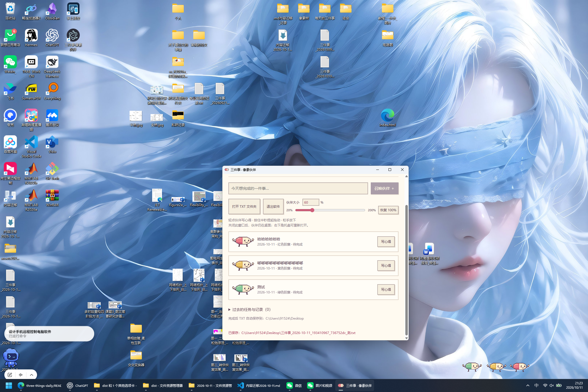
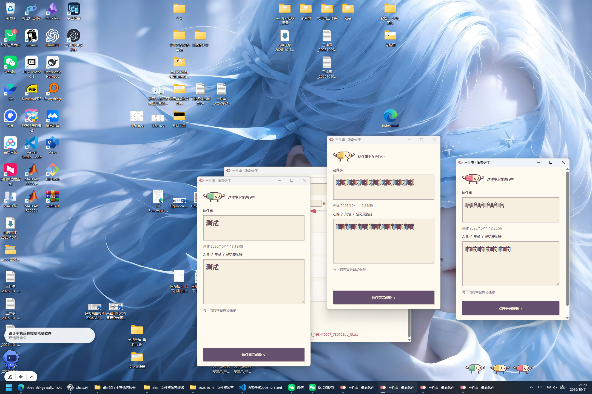
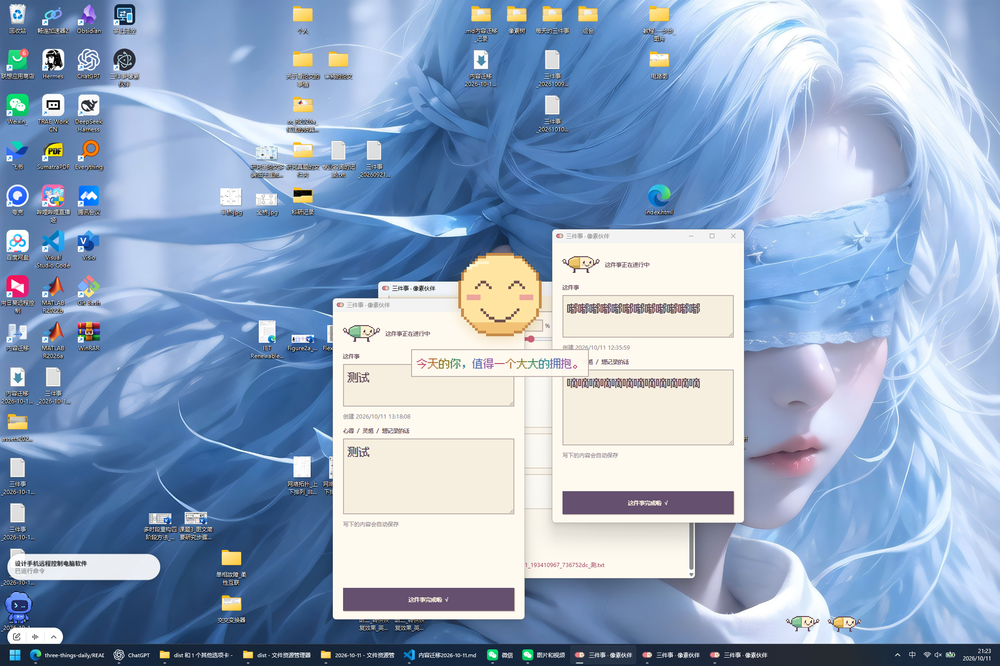
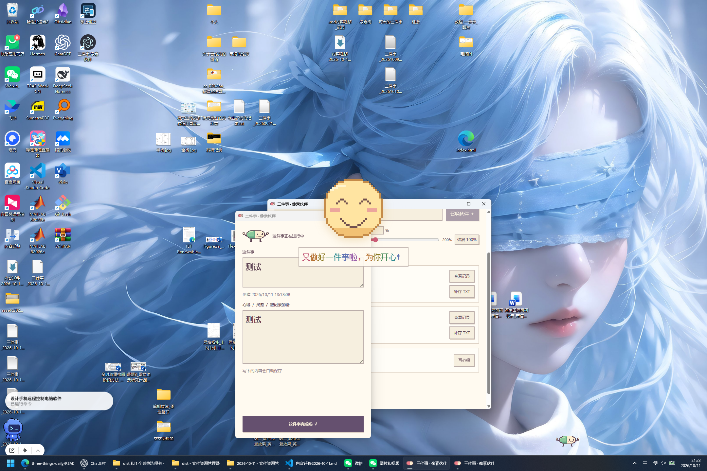
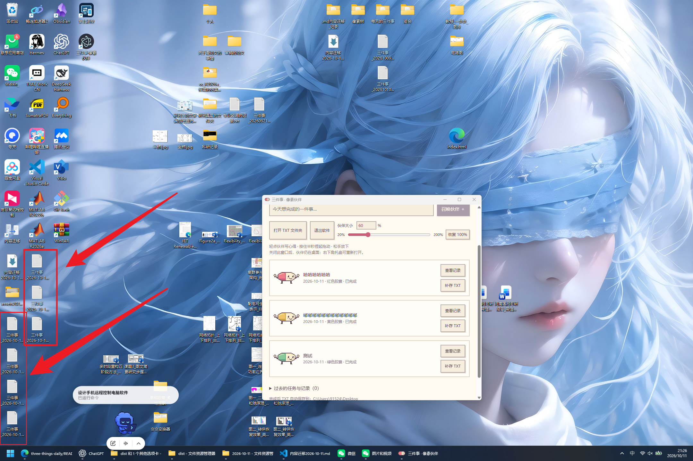

# Three Things · Pixel Companions

[简体中文](README.md) | **English**

Focus on three things each day, with cute pixel capsules keeping you company on your desktop. Tap a companion to write down your thoughts. Finish a task to see a warm smile and automatically save a plain-text TXT record.

[Download Windows v0.1.6](https://github.com/guiii007/three-things-daily/releases/download/v0.1.6/ThreeThings-0.1.6-Windows.exe) · [Browse releases](https://github.com/guiii007/three-things-daily/releases) · [Open the web app](https://guiii007.github.io/three-things-daily/)

## See how it works in five screenshots

### 1. Write down three things and meet your companions

Summon up to three capsules each day—red, yellow, and green—to accompany your tasks. Adjust their size to suit your screen and preferences.



### 2. Tap a companion to capture your thoughts

Each companion belongs to one task. Click a character to open its task window and record reflections, ideas, or next steps. Text is saved automatically.



### 3. Finish a task and receive a warm smile

Click “这件事完成啦 √” (Task complete). Its companion leaves with an animation, followed by a pixel smile and colorful encouragement that gently fade away.



### 4. Keep going, one task at a time

Completed companions leave while unfinished ones stay with you. Each completion brings encouragement, and the manager updates your progress.



### 5. Keep a record: TXT files appear on your desktop

Every completed task generates a plain-text TXT file with its content, timestamps, and notes. The red boxes and arrows highlight the desktop records.



[Download the Windows app and start your three things today](https://github.com/guiii007/three-things-daily/releases/download/v0.1.6/ThreeThings-0.1.6-Windows.exe)

## Desktop features

- **Three things a day:** Create up to three companions each day: red, yellow, then green pixel capsules. Completing a task does not free up a daily slot. The limit resets the next day.
- **Desktop company:** Companions stay above other apps. Closing the manager keeps them on your desktop; use the system tray to reopen the manager or hide your companions.
- **Free placement:** Tap a character to open its task and notes. Hold for about half a second to pick it up, drag it, and release to save its position.
- **Adjustable size:** Set 20%–200% using the slider or number field. Both controls stay in sync, changes are saved automatically, and you can reset to 100%. Characters use SVG pixel blocks, with matching click areas as they resize.
- **Text notes:** Edit tasks and capture thoughts or ideas, with automatic saving.
- **Completion feedback:** The companion disappears with an animation, followed by a pixel smile and colorful encouragement that gently fade away.
- **Desktop TXT records:** Completing a task automatically saves its text, timestamps, and notes to a TXT file on your Windows desktop. Completed tasks can be exported again.
- **Task history:** Keep previous tasks and notes. Unfinished companions remain with you, and completed tasks can be reopened.

## Getting started

1. Download the Windows EXE and double-click to run it. No Node.js installation is required.
2. Enter a task and click “召唤伙伴” (Summon companion).
3. Tap your companion to write notes, or hold for about half a second to pick it up and drag it. Release to put it down.
4. Drag the “伙伴大小” (Companion size) slider or enter an integer from 20 to 200 to adjust your desktop companions.
5. Click “这件事完成啦 √” (Task complete) when you finish. Its TXT record is saved directly to your Windows desktop.

Before upgrading, quit the old version using the manager or system tray, then launch the new version. Existing tasks, notes, and size settings are retained. The app interface currently uses Chinese; this document provides an English guide.

## Data and records

Desktop app data is stored in `%APPDATA%/three-things-companion/tasks.json`, including tasks, notes, positions, and size settings. It is not uploaded to a server. Completion records are plain-text snapshots saved directly to the Windows desktop, without date subfolders.

TXT files created by older versions remain in their original location. Click “补存 TXT” (Export TXT again) to save a record to your desktop. Reopening and completing a task again creates a new TXT file while preserving the previous completion record. Back up both the task data file and your TXT files.

The desktop app is currently a Windows trial version. Automatic updates and additional characters are not yet available.

## Web app

The original single-file web app is still available independently: [open it online](https://guiii007.github.io/three-things-daily/) or download `index.html` and open it in a browser.

It supports task management, notes, and TXT export, with a dark theme and responsive layout. Data is stored in the current browser's LocalStorage. The desktop and web apps store their data separately, with no automatic synchronization or migration.

## Development

The desktop app uses Electron, vanilla JavaScript, SVG, and an offline pixel font. Koffi reads Windows mouse state through native APIs. The web app uses HTML, vanilla JavaScript, Tailwind CSS via CDN, and LocalStorage.

```powershell
git clone https://github.com/guiii007/three-things-daily.git
cd three-things-daily
npm.cmd ci
npm.cmd test
npm.cmd start
npm.cmd run build
```

Windows builds are written to `dist`. See the [desktop guide](desktop/README.en.md) for more details on running, testing, and font licensing.

```text
three-things-daily/
├── README.md          # Chinese introduction
├── README.en.md       # English introduction
├── index.html         # Original single-file web app
├── capsule-local.html # Browser companion prototype
├── desktop/           # Electron source, assets, and tests
├── package.json       # Dependencies and development commands
└── package-lock.json  # Locked dependency versions
```

## License

MIT © [guiii007](https://github.com/guiii007). The offline pixel font's license is distributed with the app; see `desktop/assets/font/LICENSE`.
